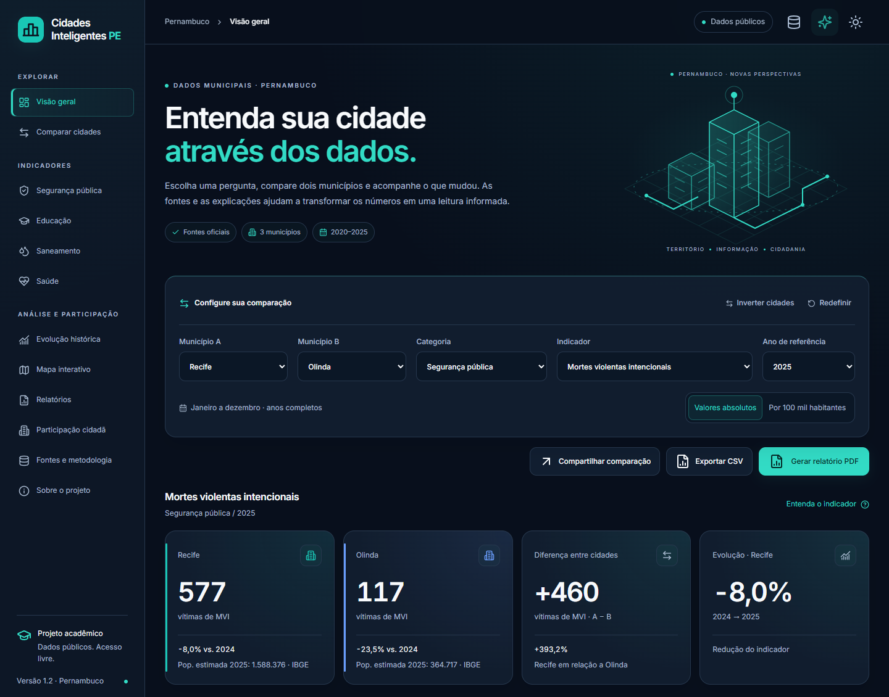

# Cidades Inteligentes PE

Painel acadêmico para comparar indicadores públicos de **Recife, Olinda e Paulista**. Reúne séries de segurança, educação, saneamento e saúde que os órgãos públicos distribuem em tabelas, APIs e relatórios. Cada comparação preserva a unidade, o período e a fonte dos dados.



## Uma comparação para explorar

Quantas pessoas foram vítimas de mortes violentas intencionais em Recife e Olinda em 2025? A série da SDS-PE registra **577 vítimas em Recife e 117 em Olinda**. No comparador, a opção **Por 100 mil habitantes** divide cada total pela população estimada do município no mesmo ano. Os resultados são **36,33** e **32,08** vítimas por 100 mil habitantes, respectivamente. Para 2022 e 2023, o painel permite consultar a contagem e indica que falta a população para calcular a taxa. [Dados usados neste exemplo](public/data/dataset.json)

No painel, você pode acompanhar a série em gráfico ou tabela, localizar o município no mapa e exportar a comparação em CSV ou PDF. A tela de evolução histórica também permite salvar o gráfico em PNG. Os filtros ficam na URL para que seja possível reabrir o mesmo recorte.

## Indicadores e fontes

A base reúne **75 observações**. O mapa mostra os 184 municípios de Pernambuco e o distrito estadual de Fernando de Noronha. Recife, Olinda e Paulista têm estatísticas nesta versão. As demais áreas aparecem em cinza. [Malha territorial do IBGE usada pelo projeto](public/data/pernambuco.geojson)

| Indicador | Cobertura temporal | Unidade | Fonte |
| --- | --- | --- | --- |
| Mortes violentas intencionais | 2020–2025 | Vítimas e taxa por 100 mil habitantes, quando disponível | [SDS-PE](https://www.sds.pe.gov.br/estatisticas/indicadores-criminais/mortes-violentas-intencionais-mvi) e [estimativas de população do IBGE](https://sidra.ibge.gov.br/tabela/6579) |
| IDEB dos anos iniciais da rede pública | 2015–2025, anos ímpares | Pontos de 0 a 10 | [Inep, via IBGE](https://servicodados.ibge.gov.br/api/v1/pesquisas/indicadores/78187) |
| IDEB dos anos finais da rede pública | 2015–2025, anos ímpares | Pontos de 0 a 10 | [Inep, via IBGE](https://servicodados.ibge.gov.br/api/v1/pesquisas/indicadores/78192) |
| Esgotamento por rede geral ou pluvial, ou fossa ligada à rede | 2022 | Percentual da população no universo domiciliar do Censo | [IBGE, Censo 2022](https://servicodados.ibge.gov.br/api/v1/pesquisas/indicadores/60030) |
| Mortalidade infantil | 2020–2025 | Óbitos por mil nascidos vivos | [DATASUS, via IBGE](https://servicodados.ibge.gov.br/api/v1/pesquisas/indicadores/30279) |

O projeto é acadêmico e independente. Os créditos, endereços das consultas e datas de coleta acompanham os arquivos em [dados públicos](public/data/).

## Como o painel foi construído

- **Coleta e tratamento.** Scripts em Node.js leem as séries oficiais, relacionam os códigos de município e validam os registros antes de salvar os arquivos usados pela aplicação. O painel consulta esses arquivos locais e pode ser executado sem chave de API. [Importadores](scripts/) · [Validação e catálogo](src/services/)
- **Lógica de comparação.** Os cálculos usam valores antes do arredondamento. Uma taxa exige população do mesmo município e ano. O gráfico mantém lacunas quando falta um dado e a exportação CSV mantém a célula vazia. [Cálculos](src/utils/calculations.js) · [Exportações](src/utils/exports.js)
- **Interface.** JavaScript, HTML e CSS compõem uma aplicação estática com Vite. Chart.js desenha os gráficos, Leaflet exibe a malha do IBGE e jsPDF gera os relatórios no navegador. A interface inclui navegação por teclado, tabelas para consultar os valores dos gráficos, temas claro e escuro e suporte a movimento reduzido. [Componentes](src/components/) · [Páginas](src/pages/)

## Executar localmente

Com Node.js 22.12 ou superior e npm, execute estes comandos na pasta do repositório.

```sh
npm ci
npm run dev
```

Abra o endereço indicado no terminal, normalmente `http://127.0.0.1:5173`. As bases de dados já estão incluídas.

| Comando | Finalidade |
| --- | --- |
| `npm test` | Executa os testes unitários com Vitest. |
| `npm run test:e2e` | Executa as verificações de navegação no Playwright. A configuração usa Microsoft Edge instalado. |
| `npm run build` | Gera a aplicação estática em `dist/`. |
| `npm run preview` | Serve o build localmente. |
| `npm run update-data` | Consulta as fontes oficiais e atualiza os arquivos. Revise as alterações antes de incorporar uma nova coleta. |

Os testes cobrem cálculos, denominadores ausentes, seleção de filtros, navegação por teclado, telas de diferentes larguras, mapa e exportação dos relatórios. [Testes unitários](tests/unit/) · [Testes de navegador](tests/e2e/)
